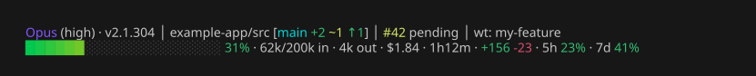

# claude-code-status-line

A two-line [Claude Code status line](https://code.claude.com/docs/en/statusline) in plain bash. No emoji, no plugin dependencies, nothing that shells out beyond `jq` and `git`.



```
Opus (high) · v2.1.304 │ example-app/src [main +2 ~1 ↑1] │ #42 pending │ wt: my-feature
████████░░░░░░░░░░░░ 31% · 62k/200k in · 4k out · $1.84 · 1h12m · +156 -23 · 5h 23% · 7d 41%
```

The image is the script's own output, captured by `docs/render.sh` with [freeze](https://github.com/charmbracelet/freeze). Colors are freeze's palette, so your terminal theme will shift them slightly.

## What it shows

**Line 1, identity: what is running and where**

| Segment | Source | Notes |
| - | - | - |
| Model | `model.display_name` | Bold blue |
| Effort | `effort.level` | In parentheses after the model. Plain for medium and high, dim for low, orange for xhigh, red for max. Hidden when the model has no effort setting |
| `fast` / `no-think` | `fast_mode`, `thinking.enabled` | Join the effort inside the parentheses, only when fast mode is on or thinking is off |
| Version | `version` + the `claude` launcher symlink | Running version, dim. Turns yellow with `↑ vNEW restart` when the native auto-updater has installed a newer build than this session is running |
| Directory | `workspace.current_dir` | Bold. Inside a repo: repo name plus the path below the root. Outside a repo: home-relative path |
| Branch | `git status --porcelain=v2 --branch` | In brackets: the branch name, then `+staged` `~unstaged` `?untracked` `↑ahead` `↓behind`, or `✓` when clean. Untracked counts files, including inside new directories |
| Pull request | `pr.*` | Clickable number (OSC 8), colored by review state. Hidden when there is no PR |
| Worktree, session name, agent | `worktree.name`, `session_name`, `agent.name` | Each shown only when set |

**Line 2, meters: every number that moves each turn**

| Segment | Source | Notes |
| - | - | - |
| Context bar | `context_window.used_percentage` | 20 blocks, truecolor gradient green → yellow → red. Percentage turns yellow at 50, orange at 75, red at 90 |
| Tokens | `context_window.total_input_tokens`, `context_window_size`; the session transcript | Input is everything currently in the context window, over the window size. Output is the session total, summed from the transcript at `transcript_path` plus any subagent transcripts, deduplicated per message. Falls back to the payload's last-response figure if the transcript is unreadable or over 50MB. Shown as `850`, `62k`, or `1.2M` |
| Cost | `cost.total_cost_usd` | Claude Code's own estimate. Resets on `/clear` |
| Duration | `cost.total_duration_ms` | Wall-clock session time |
| Lines changed | `cost.total_lines_added`, `total_lines_removed` | |
| Rate limits | `rate_limits.five_hour`, `seven_day` | Pro and Max plans only; hidden when absent. Same color thresholds as context |
| `cache cold` | `prompt_cache.warm` | Appears only when the prompt cache has expired, since the next turn will cost more |

Color rule: yellow, orange and red mean "heads up" and nothing else. They mark effort level, context and rate limit thresholds, unstaged and untracked files, and a pending restart. Identity and plain numbers stay in the default foreground.

The permission mode (default, plan, auto, accept edits) is not shown because Claude Code does not pass it to the status line. It stays visible in Claude Code's own footer, directly under this one.

## Install

Requirements: bash 3.2 or newer, `jq`, `git`, and a terminal that supports truecolor. No special font: every glyph is in the basic Unicode blocks that all monospace fonts include.

1. Clone this repo somewhere permanent.
2. Point Claude Code at the script in `~/.claude/settings.json`, replacing the path with your clone:

   ```json
   {
     "statusLine": {
       "type": "command",
       "command": "bash /path/to/claude-code-status-line/statusline.sh"
     }
   }
   ```

3. Start a new Claude Code session, or run `/statusline` and tell it to use the script above.

Edits to the script take effect on the next status line refresh, no restart needed.

## Try it without Claude Code

```sh
bash statusline.sh < samples/full.json
bash statusline.sh < samples/minimal.json
```

`samples/full.json` has every optional field populated. `samples/minimal.json` is the first render of a session, before any API call.

## Tests

```sh
bash tests/run.sh
```

Renders both samples, builds a throwaway git repo to check the branch markers and the subpath display, and confirms that control characters in directory or session names never reach the terminal.

## Design notes

- **One `jq` call** parses every field, NUL-separated so values may contain newlines.
- **No subshells in the hot path.** Colors are written into variables with `printf -v`.
- **Colors are ANSI-C quoted** (`$'\033[…'`), so the output is printed with `%s` and no external string is ever interpreted as an escape sequence. Branch, directory, session, agent and PR values are additionally stripped of control characters.
- **Update check without network.** The native installer repoints the `claude` symlink when it installs a new version, so one `readlink` compared with the payload's `version` says whether a restart would pick up a newer build. Non-native installs (Homebrew, npm) show the running version only.
- **Session output tokens come from the transcript.** Claude Code only exposes the last response's output count, so the script sums `message.usage.output_tokens` across the transcript instead. Each assistant message appears once per content block with identical usage, so the sum keeps one value per message id. Measured at about 20ms for a 2MB transcript and 135ms for 15MB.
- **One `git status` call** supplies branch, ahead/behind, and all file states. `git rev-parse --show-prefix` gives the path below the repo root and survives symlinked paths such as macOS `/var` → `/private/var`.

The gradient bar and the overall structure come from [AKCodez's status line gist](https://gist.github.com/AKCodez/ffb420ba6a7662b5c3dda2edce7783de) and the performance and sanitizing improvements proposed in its comments.
